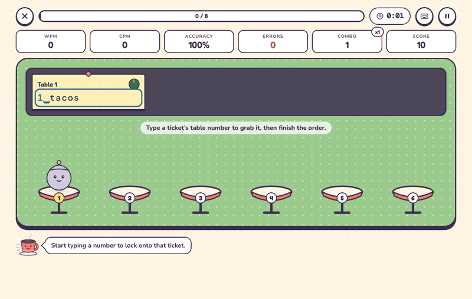
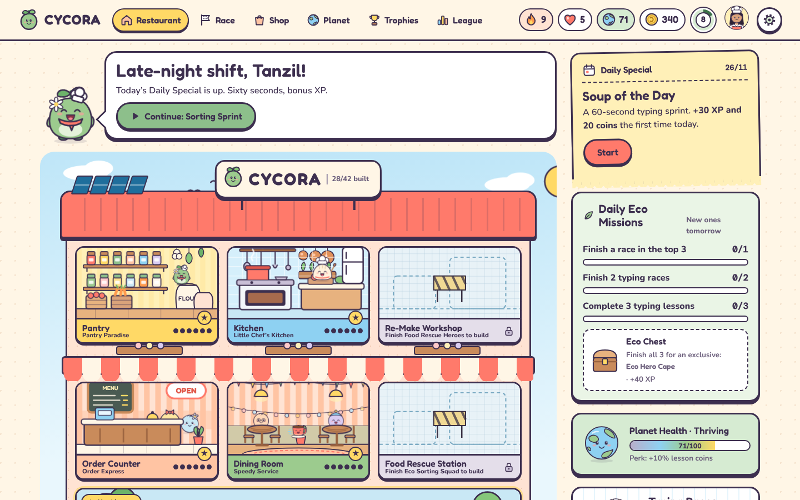
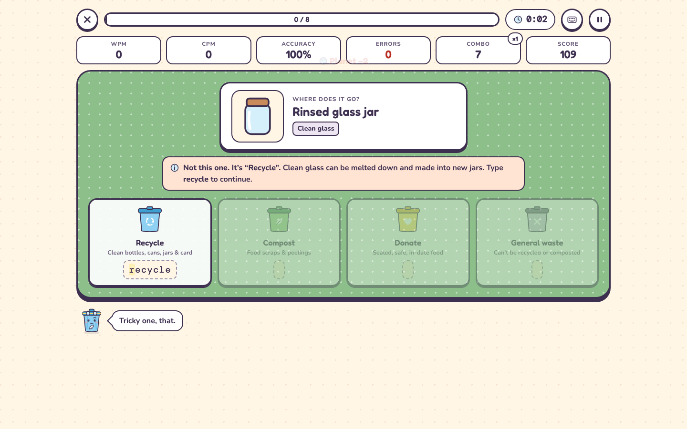

# Hi, I'm Tanzil 👋

I'm an interaction designer in London. I make games and interactive things that teach people something without feeling like a lesson.

I studied Digital Futures (BDes, Honours) at OCAD University in Toronto, and I'm now doing an MSc in Human-Computer Interaction Design with Placement at City St George's, University of London.

I like owning a project from start to finish: the user research, the game design, the characters, the writing, and the code that makes it run. This repository is where I keep that work. Each project has its own folder and README covering what it is, why I made it and how it was built.

## Projects

### 🌱 CYCORA

**A typing game where you run a small restaurant, and learn English, sustainability and circular business along the way.**

You start with an empty building and a sprout called Cy. Every lesson you finish adds something to the restaurant. You type ingredient names to stock the pantry, take orders before customers lose patience, sort waste into the right bins and decide what to do with leftover food. The choices you make change the street outside.

It started as my graduation project at OCAD, was shown at GradEx 111 and featured on OMNI News. Afterwards I rebuilt it from scratch.

| | |
| --- | --- |
|  |  |

- 42 lessons across 7 worlds, each with its own character
- Typing races, daily eco missions, achievements and a shop to customise the restaurant
- A Planet Health meter that responds to every sustainable decision
- Recycling and food-safety content checked against FSA, WRAP and GOV.UK guidance
- Playable with a keyboard only, with accessibility settings, and audited with axe-core
- Plain HTML, CSS and JavaScript, no frameworks. All the art is SVG drawn in code.

**My role:** concept, research, UX and game design, illustration, writing, development and testing

[▶ Play on itch.io](https://tanzilgargg.itch.io/cycora) · [Read the full case study](cycora/)

<!--
### 🧱 UJECSA (in progress)

My own board game: players build and buy sections of a coloured block tower. I'm turning it into a 3D multiplayer browser game.

**Built with:** Next.js, React Three Fiber, Rapier physics, Socket.IO, Supabase
-->

<!--
Copy this block for each new project and fill it in. Anything between these
comment markers is hidden on GitHub, so it's safe to leave unfinished.

### Project name

**One sentence saying what it is and who it's for.**

A short paragraph on the problem, what you made and what happened.

**My role:** ...
**Built with:** ...

[Try it](link) · [Read more](project-folder/)
-->

## What I work with

**Design:** user research, affinity mapping, personas, prototyping, usability testing, game design, illustration
**Build:** HTML, CSS, JavaScript, SVG, React, Three.js
**Tools:** Figma, Blender

## Get in touch

I'm always happy to talk about design, games or a project you think I'd like.

- itch.io: [tanzilgargg.itch.io](https://tanzilgargg.itch.io)
<!--
- LinkedIn: https://www.linkedin.com/in/your-name
- Email: you@example.com
-->

---

© Tanzil Garg. All rights reserved unless a project's own LICENSE says otherwise.
