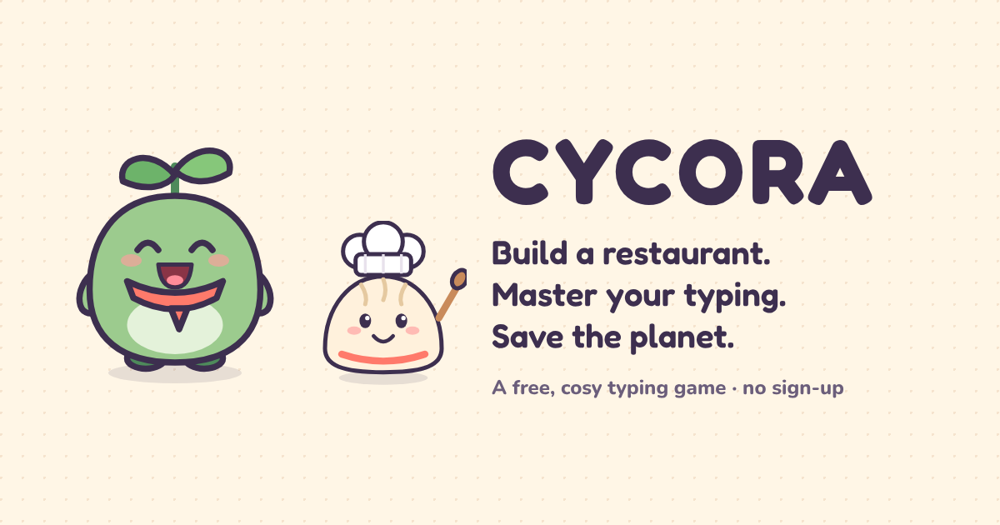
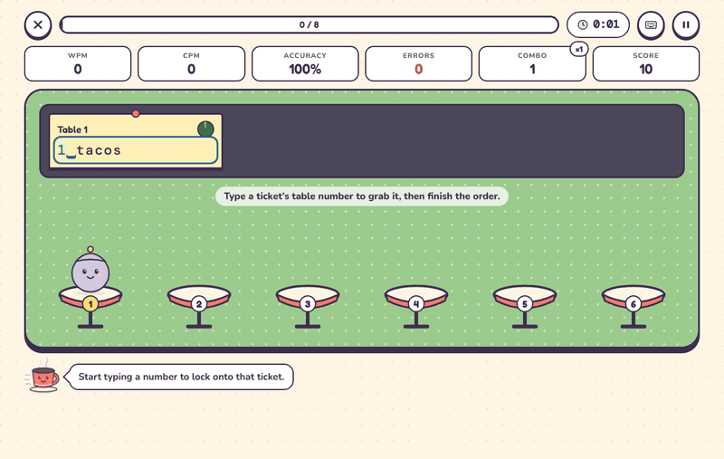
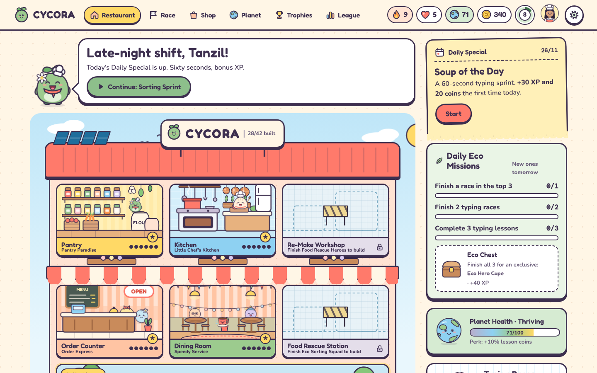
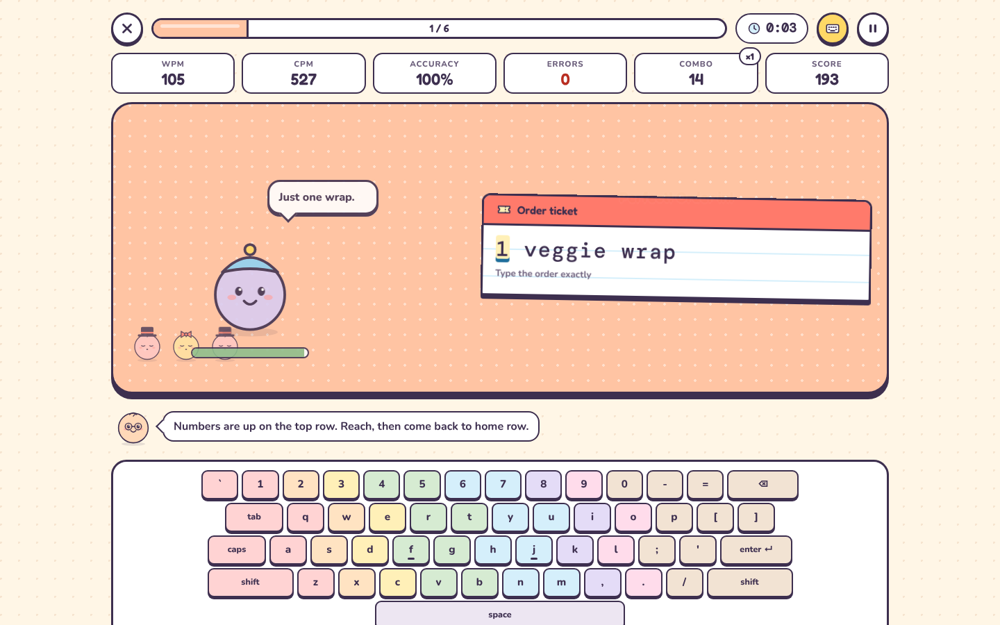
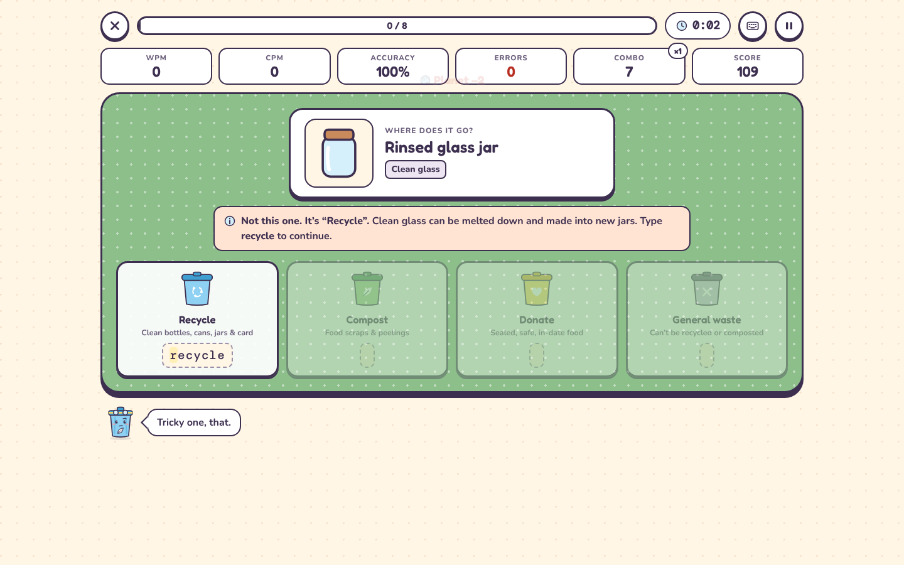
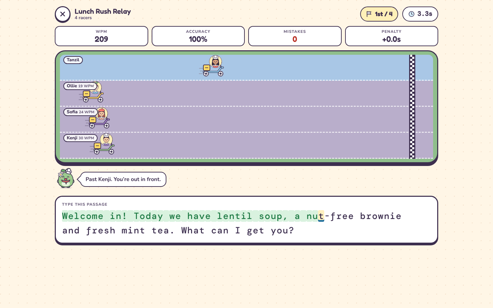
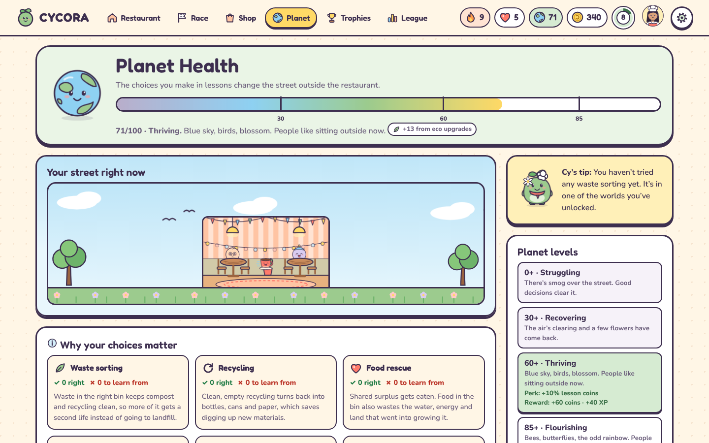
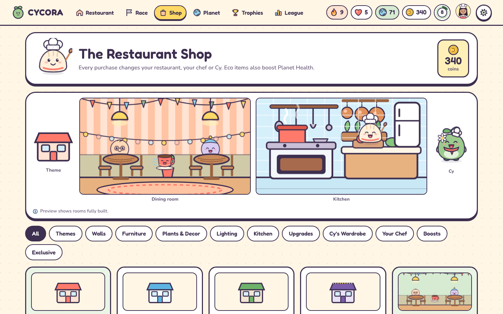
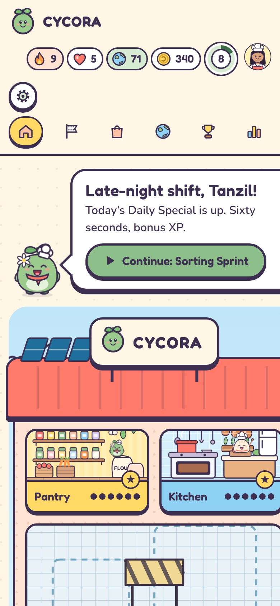
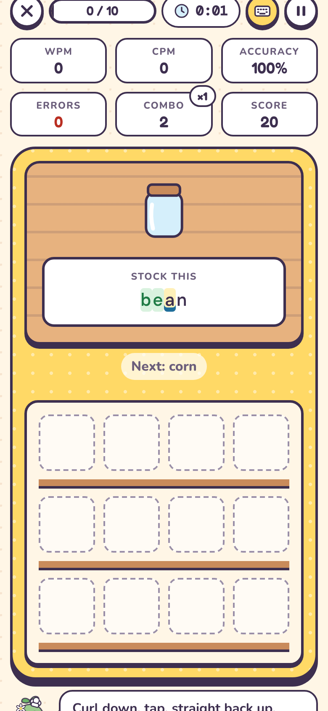

<div align="center">



**A typing game where you run a small restaurant, and learn English, sustainability and circular business along the way.**

[](https://tanzilgargg.itch.io/cycora)


[**Play it**](https://tanzilgargg.itch.io/cycora) · [Screenshots](#screenshots) · [How it works](#how-it-works) · [Design process](#design-process) · [Run it yourself](#run-it-yourself)



</div>

## About

CYCORA started as my graduation project. The first version was shown at **GradEx 111** and featured on **OMNI News**. This repository is the rebuilt version, which I designed and developed on my own.

You start with an empty restaurant and a sprout called Cy. Every lesson you finish adds something to the building: jars on the pantry shelves, a stove, tables, recycling bins out back. The typing is the gameplay itself. You type ingredient names to stock the pantry, customers' orders before they lose patience, table numbers to grab tickets during a rush, and the right bin for a greasy yoghurt pot. Each choice comes with a short explanation of why it matters.

## Screenshots

<table>
  <tr>
    <td width="50%"><br><sub><b>The restaurant.</b> Each world is a room that fills up as you learn.</sub></td>
    <td width="50%"><br><sub><b>Order Express.</b> Type orders exactly before the customer runs out of patience.</sub></td>
  </tr>
  <tr>
    <td><br><sub><b>Eco Sorting Squad.</b> Wrong answers explain why, then you type the right one.</sub></td>
    <td><br><sub><b>Typing races.</b> Mistakes add time, so accuracy matters as much as speed.</sub></td>
  </tr>
  <tr>
    <td><br><sub><b>Planet Health.</b> Every sustainable decision moves the meter and changes the street.</sub></td>
    <td><br><sub><b>The shop.</b> Coins buy themes, furniture, kitchen kit and outfits for Cy.</sub></td>
  </tr>
</table>

<p align="center">
  
  &nbsp;
  
</p>

## How it works

**Seven worlds, 42 lessons.** Each world has its own character and teaches one area:

| World | Character | What you learn |
| --- | --- | --- |
| Pantry Paradise | Cy | Home row, top and bottom rows, capitals, space, Enter, Backspace |
| Order Express | A regular customer | Greetings, menu items, numbers, dietary needs, special requests |
| Little Chef's Kitchen | Chef Momo | Ingredients, cooking verbs, following recipe steps in order |
| Speedy Service | Zippy | Reading tickets, matching tables, prioritising under pressure |
| Eco Sorting Squad | Binnie | Recycling, compost, donation, general waste, contamination |
| Food Rescue Heroes | Olive | Use-by versus best-before, safe storage, donating surplus |
| Re-Make Magic | Juno | How coffee grounds, cooking oil, cardboard, glass and plastic get a second life |

**Three ways to play.** Typing items one at a time; juggling several tickets at once, where typing a table number grabs that ticket; and making decisions by typing the answer.

**Around the lessons:**
- **Typing races** against three AI chefs matched to your speed, plus a ghost of your personal best.
- **Planet Health**, which every recycling, rescue and storage decision moves. It changes the street outside, from smog to blossom, and unlocks rewards.
- **Daily eco missions**, weekly missions, streaks, XP, coins, 30 achievements and a weekly league.
- **Customisation**: themes, wallpaper, furniture, lighting, kitchen equipment and outfits for both your chef and Cy.
- **The Restaurant Licence**: a final six-stage shift, scored on typing, service, food safety, waste and efficiency. You get a printable certificate at the end.

## Design process

A few decisions I'm proud of:

- **Typing is the mechanic, not a quiz bolted on.** Ticket lock-on, recipe ordering and typed decisions all came from asking what typing would feel like inside a real restaurant shift.
- **Forgiving by default.** Hearts only drop when you fail a lesson you've never passed, and replaying a lesson earns them back. Difficulty adapts: I checked that every timed lesson can be passed at 10 words per minute, because that's where many beginners and children start.
- **Feedback that teaches.** A wrong decision is never just "wrong". You see why, then type the right answer, so the correct choice is the last thing your fingers did.
- **Checked content.** The recycling and food-safety advice follows the Food Standards Agency, WRAP / Recycle Now and GOV.UK guidance. Sources are listed in the game's About page.
- **Accessible.** Fully keyboard-playable. Feedback never relies on colour alone. There are settings for text size, high contrast, reduced motion and sound. An automated audit with axe-core across 20 screens finds no issues.
- **Private.** No accounts, cookies or tracking. Progress stays in the player's browser, with a backup and restore option.

## Run it yourself

No build step and no dependencies.

Download or clone the repository, open the `cycora` folder, and open `index.html` in a browser. To run it the way it runs online:

```bash
cd cycora
python3 -m http.server 8000   # then visit http://localhost:8000
```

Serving it over `http` turns on offline mode and "add to home screen". Opening `index.html` directly also works, just without those two.

## Project structure

```
index.html              page shell
css/                    design system and screen styles
fonts/                  self-hosted fonts (SIL Open Font License)
icons/                  app icons and social preview
js/core/                saving, sound, helpers, pop-ups
js/art/                 every character, room and icon, drawn as SVG in code
js/data/                lessons (worlds.js), shop, achievements and missions (meta.js)
js/systems/             progression rules and Planet Health
js/engine/              typing engine and on-screen keyboard
js/game/                gameplay modes and lesson flow
js/screens/             restaurant, worlds, shop, profile, race, planet, licence, about
docs/                   screenshots, deployment guide, playtest kit
```

Built with plain HTML, CSS and JavaScript, with no frameworks. All the art is drawn in code as SVG, and the sound effects are generated live with the Web Audio API.

## Documentation

- [Deployment guide](docs/DEPLOY.md): putting CYCORA online with GitHub Pages or Netlify, plus device checks.
- [Playtest kit](docs/PLAYTEST.md): tasks and questions for running sessions with real players.
- [Changelog](CHANGELOG.md)

## Feedback

Found a bug or have an idea? Open an issue in this repository's **Issues** tab and pick "Bug report" or "Feedback or idea". I read everything.

## Licence

© 2026 Tanzil Garg. All rights reserved. You're welcome to look around and play, but please don't reuse the code, art or writing without asking. Fonts are under the SIL Open Font License. See [LICENSE](LICENSE).
